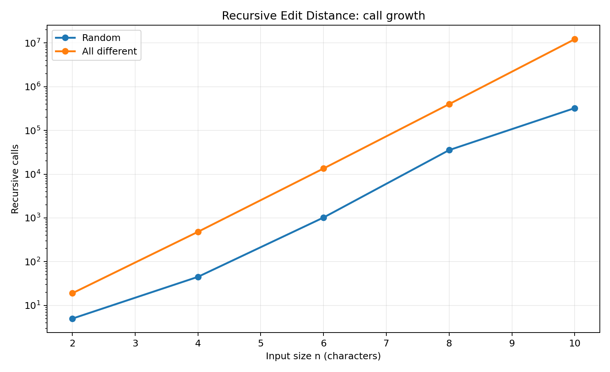

# Assignment 4 — Dynamic Programming and String Algorithms

**Course:** Design and Analysis of Algorithms  
**Student:** Alikhan Zhambayev  
**Group:** SE-2517  
**University:** Astana IT University

## 1. Experiment Design Card

| Field | Edit Distance | String Search |
|---|---|---|
| Question | How do recursion, full-table DP and two-row DP scale as input size increases? | How do Naive and KMP perform on random and difficult inputs? |
| Sizes | Recursive: 2, 4, 6, 8, 10. DP: 100, 200, 400, 800, 1600. | 1000, 4000, 16000, 64000, 256000. |
| Inputs | Random strings and completely different strings. | Random strings and repeated-character worst-case inputs. |
| Metrics | Recursive calls or computed DP cells; execution time in milliseconds. | Character comparisons during search; execution time in milliseconds. |
| Prediction | Recursion will grow exponentially on difficult inputs. Both DP implementations will have O(n²) time for equal-length strings. | Naive will perform many comparisons on repeated characters. KMP will avoid repeated checks. |
| Plots | Recursive calls on a logarithmic scale; DP execution time. | Comparisons, execution time and comparison ratio. |

All random inputs use a fixed seed of 42. Each configuration is executed five times. Every individual execution is recorded in `results/results.csv`, and the median execution time is used for plots and analysis.

The recursive algorithm uses smaller inputs because its running time increases rapidly. Larger sizes are used for the dynamic programming and string search algorithms.

## 2. Algorithms and Metrics

### 2.1 Edit Distance

Three implementations of Levenshtein distance were tested:

- **Recursive:** direct recursion without memoization.
- **Table:** bottom-up dynamic programming with an (n+1) × (m+1) table.
- **TwoRows:** dynamic programming using only two rows.

The recursive counter records the number of function calls. The DP counter records the number of computed inner table cells. These counters measure different units of work and should not be interpreted as identical machine operations.

For equal-length strings, both DP versions compute n² inner cells.

### 2.2 String Search

Two string matching algorithms were tested:

- **Naive:** tries every possible starting position.
- **KMP:** uses the Longest Prefix Suffix (LPS) array to avoid unnecessary comparisons.

The comparison counter records character comparisons during the search phase. In the current implementation, LPS preprocessing comparisons are not included in the KMP counter, although preprocessing time is included in the execution time.

## 3. Experimental Results

### 3.1 Recursive Edit Distance

**Takeaway:** The number of recursive calls grows very rapidly on completely different strings, confirming the high cost of repeated subproblems.

For completely different strings, the number of recursive calls increased from 19 at n=2 to 12,146,179 at n=10.

At n=10, the median execution time was approximately 28.06 ms for this input. This shows why direct recursion is unsuitable for large strings.

### 3.2 Full Table vs Two Rows

**Takeaway:** Both dynamic programming implementations show approximately quadratic growth, while TwoRows generally uses less time in these measurements.

At n=1600 with completely different strings:

| Algorithm | Median time | Operations |
|---|---:|---:|
| Table | 15.9755 ms | 2,560,000 |
| TwoRows | 9.2918 ms | 2,560,000 |

Both algorithms compute the same number of DP cells and return the same edit distance.

The main advantage of TwoRows is its reduced memory requirement, from O(nm) to O(min(n,m)).

### 3.3 String Search — Difficult Input

**Takeaway:** Naive performs substantially more character comparisons than KMP when the text contains long repeated sequences.

At n=256000:

| Algorithm | Comparisons | Median time |
|---|---:|---:|
| Naive | 8,191,008 | 16.1495 ms |
| KMP | 511,969 | 1.2006 ms |

Naive performs approximately 16 times more counted search comparisons.

### 3.4 Search Execution Time

**Takeaway:** KMP has a clear running-time advantage on the selected difficult input, especially for large texts.

### 3.5 Random Input Comparisons

**Takeaway:** On random inputs, Naive and KMP perform similar numbers of comparisons because most mismatches occur early.

At n=256000, Naive recorded 341,044 comparisons and KMP recorded 315,810 comparisons.

### 3.6 Comparison Ratio

**Takeaway:** On the selected difficult inputs, Naive performs approximately 16 times as many counted search comparisons as KMP for large n.

The experiment uses a pattern of up to 32 characters, so this ratio should not be treated as a universal bound for all pattern lengths.

## 4. Prediction vs Result

### Edit Distance

I expected the recursive algorithm to become much more expensive as the strings became longer. The results confirmed this prediction, especially for completely different strings. The DP algorithms showed quadratic growth in their operation counters. TwoRows produced the same answers as Table while requiring much less additional memory.

### String Search

I expected Naive to perform poorly when many characters matched before a mismatch. The results confirmed this prediction. KMP performed fewer comparisons on the difficult input because it reused prefix information. On random inputs, the difference was much smaller than on repeated-character inputs.

## 5. Short Answers

### 5.1 Which input made string search slowest, and why?

The repeated-character input was the most difficult for Naive search. The text contained only `a` characters, while the pattern contained many `a` characters followed by `b`. Naive repeatedly compared almost the entire pattern before discovering the mismatch. KMP avoided much of this repeated work by using the LPS array.

### 5.2 How large an n could recursive Edit Distance handle?

The largest recursive input tested was n=10. On completely different strings, it required 12,146,179 recursive calls. The algorithm still completed, but the number of calls was already increasing very rapidly. Larger sizes were not included because direct recursion repeats many subproblems and can become impractically slow.

### 5.3 What do we gain and lose with TwoRows?

TwoRows reduces extra memory from O(nm) to O(min(n,m)). It still computes the same edit distance in O(nm) time. However, it does not retain the complete DP table. Therefore, reconstructing the exact sequence of editing operations is less straightforward.

### 5.4 Which string search algorithm would I choose for the city platform?

I would choose KMP for searching patterns in large log files. Its worst-case time complexity is O(n+m), including LPS preprocessing. It performs especially well when the text contains repeated patterns. Naive is simpler, but KMP provides more predictable performance on difficult inputs.

## 6. Discussion of Execution Time

Execution time was measured using `System.nanoTime()` and converted into milliseconds. Each configuration was executed five times, and the median was used to reduce the influence of unusually slow or fast runs. Some measurements, especially for small inputs, were affected by JVM warm-up, JIT compilation and system activity. Therefore, time alone is not sufficient evidence of algorithmic complexity. The operation and comparison counters provide additional evidence of how the algorithms scale.

## 7. Conclusion

The experiments demonstrate the importance of selecting an appropriate algorithm for the input size and structure.

Direct recursive Edit Distance repeats many calculations and becomes expensive on difficult inputs. Dynamic programming avoids this repeated work, and TwoRows reduces memory usage without changing the result. For string searching, KMP provides a substantial advantage over Naive on repeated-character inputs, while their performance can be similar on random data.

The results generally agree with the theoretical complexity of the algorithms.

